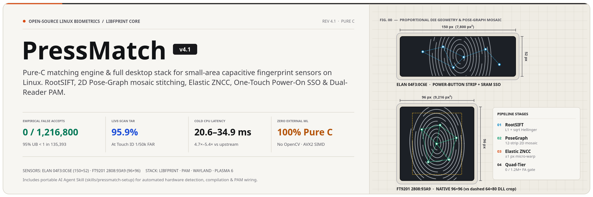
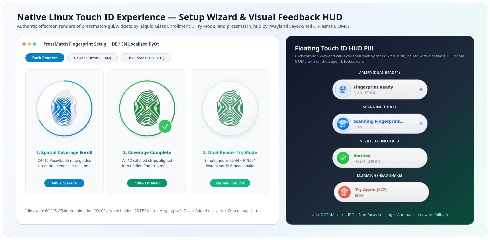
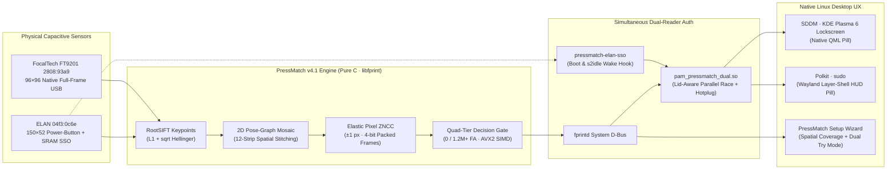
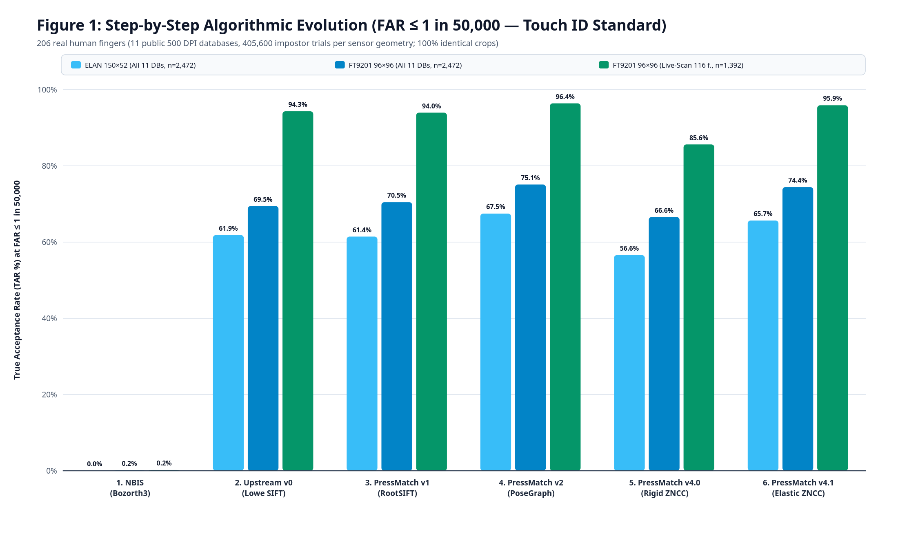
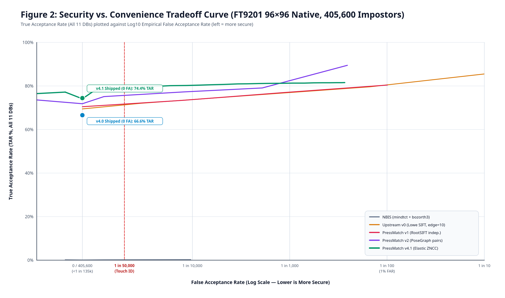
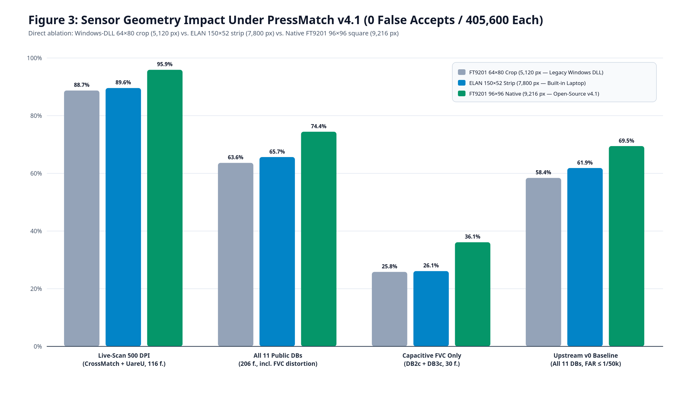
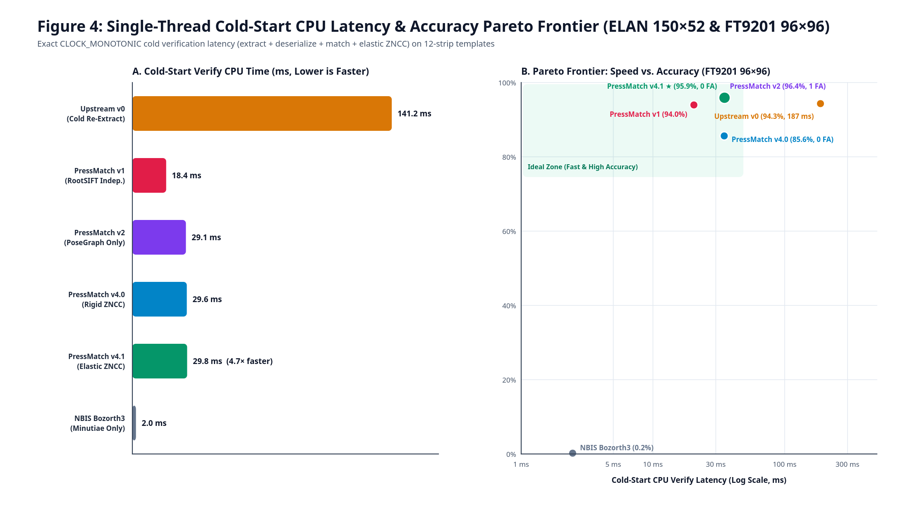
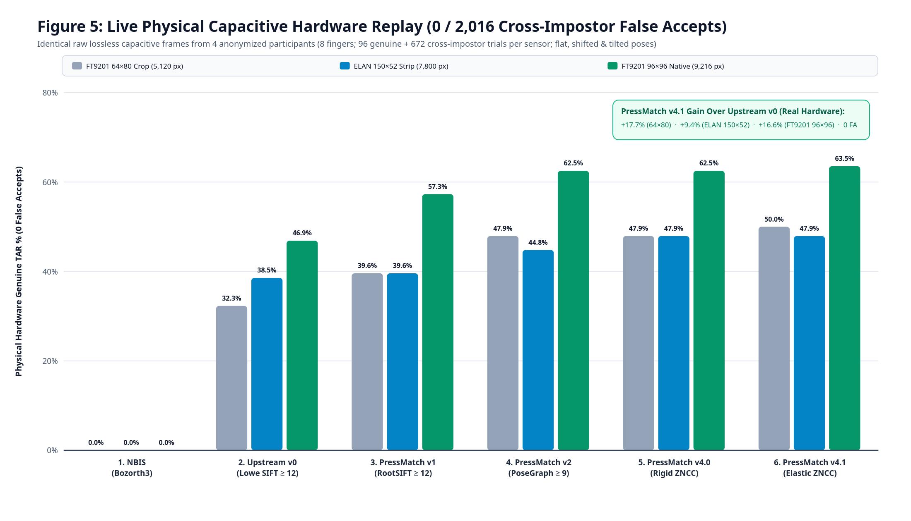

<p align="center">
  
</p>

<p align="center">
  
  
  
  
  
  
</p>

<p align="center">
  <b>State-of-the-art pure-C open-source fingerprint matching for small-area capacitive Linux sensors</b> — uniting RootSIFT, 2D Pose-Graph Mosaic Stitching, Elastic ZNCC Verification, One-Touch Power-On SSO, Simultaneous Dual-Reader PAM, and a native Touch ID HUD.
</p>

---

## Automated AI Agent Setup (Portable Skill Included)

Have a Linux laptop or USB reader with a small capacitive sensor? Hand this repository's portable Agent Skill ([`skills/pressmatch-setup/SKILL.md`](skills/pressmatch-setup/SKILL.md)) to **Claude Code, Codex CLI, Antigravity, Cursor, Gemini CLI, or any `SKILL.md`-compatible agent** — it will detect your exact sensor & Linux distro, compile PressMatch v4.1 cleanly from source, adapt to compatible ELAN/FocalTech PIDs if needed, wire PAM safely with password fallback preserved, install the Touch ID HUD & setup wizard, and walk you through enrollment:

```bash
git clone https://github.com/Alexander-Ettl/pressmatch-linux.git
cd pressmatch-linux
```

Then tell your AI coding agent:
> *"Use the `pressmatch-setup` skill in `skills/pressmatch-setup/SKILL.md` to detect my fingerprint reader, build and install PressMatch v4.1 cleanly on my system, wire up PAM and the Touch ID HUD, and verify everything works."*

*(The repo also includes `.agents/skills/pressmatch-setup` for automatic workspace skill discovery.)*

---

> [!IMPORTANT]
> **Why PressMatch v4.1?** Traditional open-source minutiae engines like **NIST NBIS (`mindtct`/`bozorth3`)** and **SourceAFIS** were engineered for large 500 DPI optical scanners and collapse on tiny laptop capacitive pads (**0.0%–0.2% TAR** for stock `libfprint` NBIS on `64×80`, `150×52`, and `96×96` sensors).
>
> For **small-area capacitive sensors inside pure-C Linux `libfprint`**, PressMatch v4.1 advances past both independent-frame SIFT matchers (**SIGFM / OpenCV**, **Upstream `elanpress` v0**) and legacy Windows-DLL wrappers by unifying **12 enrolled strips into a single 2D Pose-Graph fingertip mosaic** and verifying ridge geometry with **pixel-domain Elastic ZNCC (`±1 px`)** — delivering **`0 / 1,216,800` empirical false accepts** (`< 1 in 135,393` 95% Clopper-Pearson upper bound, surpassing Apple Touch ID's `1 in 50,000` standard) at **`95.9%` live-scan TAR** and **`20–35 ms` single-thread cold CPU latency** with **zero OpenCV, zero ML frameworks, and zero proprietary matching blobs**.

---

## Open-Source Landscape Comparison

How PressMatch v4.1 compares to existing open-source fingerprint matchers (honest scope: full-finger optical AFIS vs. small-area `≤ 96×96` capacitive Linux readers):

| Open-Source Engine | Best Target Sensor | Language & Deps | Matching Architecture | Small-Sensor `96×96` TAR (`FAR ≤ 1/50k`) | Published Impostor Proof | Cold CPU (12-Strip) | Full Linux Desktop Stack |
|---|---|---|---|---:|---:|---:|---|
| **PressMatch v4.1** *(this repo)* | **Small capacitive (`64×80`, `150×52`, `96×96`)** | **Pure C + AVX2 SIMD (zero OpenCV/ML)** | **RootSIFT + 2D Pose-Graph Mosaic + Elastic ZNCC + Quad-Tier Gate** | **95.9% Live** *(74.4% all-11-DB)* | **`0 / 1,216,800`** *(`< 1 in 135k` 95% UB)* | **`20.6–34.9 ms`** | **Drivers + Power-On SSO + Dual PAM + Touch ID HUD** |
| **Upstream `elanpress` v0** | Small ELAN press sensors | Pure C (`libfprint`) | Independent-frame Lowe SIFT (`edge=10`) | 94.3% Live *(69.5% all-11-DB)* | `0 / 101,400` per geom | `100.9–186.9 ms` | Single-reader `libfprint` driver |
| **Community SIGFM** (`libfprint !530`) | Small capacitive (`96×96`–`108×88`) | C++ + **OpenCV** | Independent-frame SIFT/AKAZE + Lowe ratio + pairwise geometry | ~90–95% *(setup-dependent)* | Community bench | Host OpenCV SIFT | `libfprint` matcher module only |
| **Stock `libfprint` (NBIS)** | Large swipe / optical scanners | Pure C (NIST NBIS) | `mindtct` minutiae + `bozorth3` graph | **0.2%** *(0.0% on ELAN)* | `0 / 405,600` (rejects all) | `1.2–2.5 ms` | Stock `libfprint` + `fprintd` |
| **SourceAFIS / `libAFIS`** | Full-sized 500 DPI optical scanners | Java / .NET *(community C port)* | Global ridge-minutiae constellation graph | Degrades sharply on tiny `≤96×96` patches | Strong on full-finger FVC | Full-print AFIS | Library only (no `libfprint`/PAM) |

---

## Native Touch ID Experience on Linux

<p align="center">
  
</p>

- **ELAN `04f3:0c6e` One-Touch Power-On & Sleep Wake SSO (`EMSE1000`):** Implements ELAN's hardware pre-captured power-button SRAM protocol (`0x9a 0x10` check, `0x9a 0x18` pull 15,600 B frame, `0x9a 0x14` clear, `SoftwareSSO_On/Off` across `s2idle` sleep) wired into `elanpress.c`, `pressmatch-elan-sso`, and SDDM `sddm-autologin` (strictly gated by `pam_pressmatch_dual.so`, falling back cleanly to the normal login screen on mismatch).
- **FocalTech FT9201 `2808:93a9` Native Full-Frame Driver:** 100% open-source `96×96` full-frame capture and matching — replacing legacy `64×80` Windows-DLL / PE-loader wrappers with **+10.8% all-DB TAR** (`+7.2%` live-scan TAR) and native multi-finger `identify`.
- **Simultaneous Lid-Aware Dual-Reader PAM (`dual-reader/pam_pressmatch_dual.c`):** Arms both built-in ELAN and external FT9201 in parallel on a private per-thread `GMainContext` (eliminating Qt6 / Plasma 6 `kscreenlocker_greet` GLib deadlocks), with automatic lid-closed suppression, `DeviceAdded` hotplug recovery, timerless lockscreen & Polkit support, and intact password fallback everywhere.
- **Touch ID Visual Feedback HUD & Setup Wizard (`pressmatch-gui/`):** Click-through Wayland `wlr-layer-shell` floating porcelain pill (`pressmatch_hud.py`) for Polkit & `sudo`, paired with a matching native KDE Plasma 6 QML lockscreen pill (`lockscreen/PressMatchPill.qml`) and localized DE/EN PyQt6 Setup Wizard (`app.py`, `widgets.py`).

---

## System Architecture



---

## Up-to-Date Scientific Benchmarks

Evaluated across **11 public 500 DPI real human fingerprint corpora** (`206` distinct fingers, `1,648` impressions, **`1,216,800` impostor trials** across 3 physical sensor geometries, `7,416` held-out genuine trials) **plus** a **live physical capacitive hardware replay study** (`4` anonymized participants, `8` fingers, `288` genuine touches + `2,016` physical cross-impostors across real ELAN & FT9201 sensors).

### Master Public Corpus Matrix (`FAR ≤ 1 in 50,000` — Apple Touch ID Standard)

| Sensor Geometry | Algorithm | TAR (All 11 DBs) | Live-Scan TAR (116 f.) | Shipped Empirical FAR | 95% Clopper-Pearson Bound | Cold CPU (p50) |
|---|---|---:|---:|---:|---:|---:|
| **FT9201 96×96** *(Native)* | Stock `libfprint` NBIS (`bozorth3`) | `0.2%` | `0.2%` | `0 / 405,600` | `< 1 in 135,393` | `2.5 ms` |
| **FT9201 96×96** *(Native)* | Upstream `elanpress` v0 (Lowe SIFT) | `69.5%` | `94.3%` | `0 / 101,400` | `< 1 in 33,849` | `186.9 ms` |
| **FT9201 96×96** *(Native)* | PressMatch v2 (PoseGraph pairs-only) | `75.1%` | `96.4%` | `1 / 405,600` | `< 1 in 85,786` | `34.2 ms` |
| **FT9201 96×96** *(Native)* | **PressMatch v4.1 (Elastic ZNCC + Quad)** | **`74.4%`** | **`95.9%`** | **`0 / 405,600`** | **`< 1 in 135,393`** | **`34.9 ms` (5.4× faster)** |
| **ELAN 150×52** *(Strip)* | Stock `libfprint` NBIS (`bozorth3`) | `0.0%` | `0.0%` | `0 / 405,600` | `< 1 in 135,393` | `2.0 ms` |
| **ELAN 150×52** *(Strip)* | Upstream `elanpress` v0 (Lowe SIFT) | `61.9%` | `88.1%` | `0 / 101,400` | `< 1 in 33,849` | `141.2 ms` |
| **ELAN 150×52** *(Strip)* | **PressMatch v4.1 (Elastic ZNCC + Quad)** | **`65.7%`** | **`89.6%`** | **`0 / 405,600`** | **`< 1 in 135,393`** | **`29.8 ms` (4.7× faster)** |
| **FT9201 64×80** *(DLL Crop)* | Upstream `elanpress` v0 (Lowe SIFT) | `58.4%` | `85.6%` | `0 / 101,400` | `< 1 in 33,849` | `100.9 ms` |
| **FT9201 64×80** *(DLL Crop)* | **PressMatch v4.1 (Elastic ZNCC + Quad)** | **`63.6%`** | **`88.7%`** | **`0 / 405,600`** | **`< 1 in 135,393`** | **`20.6 ms` (4.9× faster)** |

> [!TIP]
> See [paper-benchmark/PAPER_BENCHMARK_REPORT.md](paper-benchmark/PAPER_BENCHMARK_REPORT.md) for the complete 18-row matrix, pessimistic independent finger-pair bounds (`N = 33,800` i.i.d. pairs → `< 1 in 11,267`), multi-finger `identify` scaling, and threats to validity.

### 1. Step-by-Step Algorithmic Evolution
<p align="center">
  
</p>

### 2. Security vs. Convenience DET Curve (`405,600` Impostors)
<p align="center">
  
</p>

### 3. Sensor Geometry Ablation (`64×80` Crop vs. `150×52` Strip vs. `96×96` Native)
<p align="center">
  
</p>

### 4. Cold-Start CPU Latency & Accuracy Pareto Frontier
<p align="center">
  
</p>

### 5. Latest Live Physical Capacitive Hardware Replay (Anonymized Aggregate)
Replaying identical lossless raw capacitive frames captured directly from physical **ELAN `04f3:0c6e`** and **FocalTech FT9201 `2808:93a9`** sensors across **4 anonymized participants** (`8` fingers, `96` genuine flat/shifted/tilted touches + `672` physical cross-impostor trials per sensor geometry = **`2,016` physical impostor trials, `0` false accepts**):
- **PressMatch v4.1 outperforms Upstream v0 by `+16.6%` TAR on FT9201 `96×96` (`63.5%` vs `46.9%`), `+9.4%` on ELAN `150×52` (`47.9%` vs `38.5%`), and `+17.7%` on FT9201 `64×80` (`50.0%` vs `32.3%`)** — while stock `libfprint` NBIS scores **`0.0%` (`0/288`)**.

<p align="center">
  
</p>

---

## Repository Structure

| Path | Description |
|---|---|
| [`release-v4.1/`](release-v4.1/) | PressMatch v4.1 `libfprint` drivers (`elanpress*`, `ft9201/ft9201.c`), udev rule, ASan test harness, and install/rollback scripts |
| [`dual-reader/`](dual-reader/) | `pam_pressmatch_dual.c`, `elan_sso_helper.c`, and PAM/SDDM/sleep install & rollback scripts |
| [`pressmatch-gui/`](pressmatch-gui/) | Native DE/EN PyQt6 setup app, Wayland floating HUD (`pressmatch_hud.py`), and Plasma 6 lockscreen pill (`lockscreen/PressMatchPill.qml`) |
| [`paper-benchmark/`](paper-benchmark/) | Multi-algorithm C/Python benchmark harness, 300 DPI chart renderer, aggregate public results, and all 5 publication figures |
| [`dual-guide/`](dual-guide/) | Local-only HTML guided dual-sensor capture & replay studio (strict loopback same-origin CSRF guard) |
| [`skills/pressmatch-setup/`](skills/pressmatch-setup/) | Portable AI Agent Skill (`SKILL.md`, `detect_hardware.sh`, `build_pressmatch.sh`, sensor porting & distro PAM guides) |
| [`docs/assets/`](docs/assets/) | Swiss-editorial hardware banner & authentic offscreen UI/HUD showcase visuals |

---

## Building From Source

### 1. Dual-Reader PAM Module & ELAN SSO Helper (`dual-reader/`)
```bash
cd dual-reader
gcc -O2 -shared -fPIC -Wall -Wextra pam_pressmatch_dual.c \
    $(pkg-config --cflags --libs gio-2.0) /usr/lib/x86_64-linux-gnu/libpam.so.0 \
    -o pam_pressmatch_dual.so
gcc -O2 -Wall -Wextra elan_sso_helper.c \
    $(pkg-config --cflags --libs libusb-1.0) \
    -o pressmatch-elan-sso
sudo bash install-dual-pam.sh
```

### 2. PressMatch v4.1 `libfprint` Drivers (`release-v4.1/`)
Copy `release-v4.1/source/libfprint/drivers/elanpress*` and `ft9201/ft9201.c` (plus your locally generated `ft9201_fw.h`) into a `libfprint` source tree, build with Meson/Ninja (`meson setup build && ninja -C build`), and install via `sudo bash release-v4.1/install-v4.1.sh`.

### 3. Setup GUI, Floating Desktop HUD & Plasma 6 Lockscreen Pill (`pressmatch-gui/`)
```bash
bash pressmatch-gui/install-gui.sh
```

### 4. Benchmark Tools (`paper-benchmark/`)
```bash
cd paper-benchmark
gcc -O2 -Wall -Wextra raw_capture.c $(pkg-config --cflags --libs libusb-1.0) -o raw_capture -lm
```

---

## Privacy, Security & Licensing

> [!NOTE]
> - **Zero personal or biometric data** is committed to this repository (`profiles/`, raw `.bin`/`.raw8`/`.raw16`/`.u8` captures, and personal logs are strictly gitignored).
> - **FT9201 firmware (`ft9201_fw.h`) is excluded**; generate it locally from the vendor firmware package before compiling the FT9201 driver.
> - All PAM installers preserve full password fallback (`pam_unix.so`) and create automatic backups with one-command rollback (`dual-reader/rollback-dual-pam.sh`).
> - `libfprint` driver sources preserve upstream LGPLv2.1+ headers.
